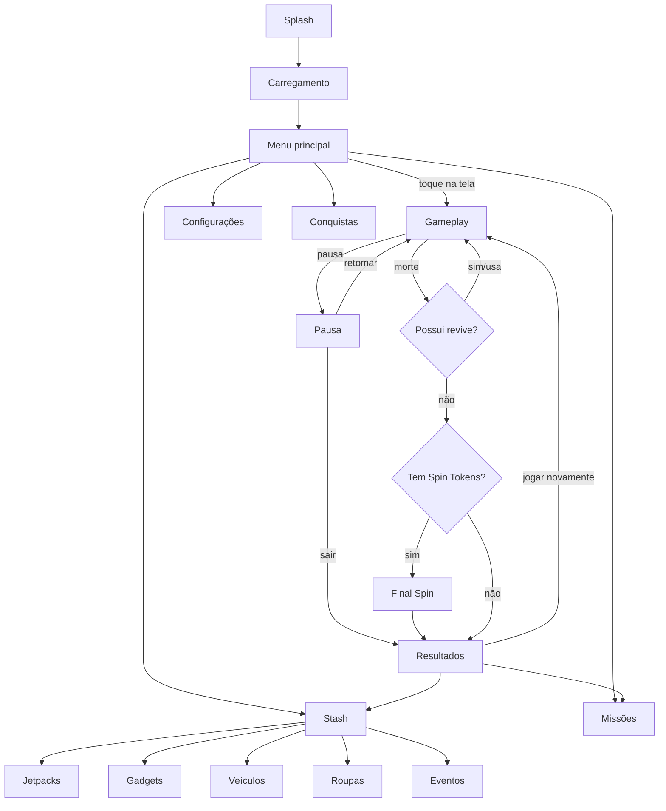

# 02 — Catálogo inicial de telas e mapa de navegação

> Estado: **inventário inicial**. Posições, dimensões, cores e tipografia exatas
> exigem capturas de tela da versão de referência (não disponíveis nesta sessão).
> Tudo aqui é [G] salvo indicação. A documentação visual detalhada (wireframes,
> espaçamentos, estados) é o entregável da **Fase 2**.
>
> Para a implementação própria, cada tela terá visual **original**; este
> catálogo registra **função e fluxo**, não aparência a ser copiada.

## 1. Inventário

| # | Tela | Objetivo | Componentes principais observados/esperados | Conf. |
|---|---|---|---|---|
| T01 | Splash | Logos da publisher/estúdio | Logo animado, fade-in/out, sem interação | [G] |
| T02 | Carregamento | Carregar assets/dados | Barra ou animação de progresso; dicas | [G] |
| T03 | Menu principal / "título" | Ponto de partida | A partida **começa a partir do menu**: o personagem entra correndo/arrombando a parede do laboratório ao tocar a tela. Botões laterais para Stash/loja, missões, configurações; exibição de recorde e moedas. | [G] |
| T04 | Gameplay (HUD) | Partida | Distância (m) no canto sup. esquerdo; moedas coletadas; botão de pausa; indicador de missões completadas durante a partida (pop-up); alertas de míssil na borda direita | [G] / [C] alertas (S2) |
| T05 | Pausa | Suspender a partida | Retomar, sair/encerrar, configurações de som; lista das 3 missões atuais com progresso | [G] |
| T06 | Game Over / resultados | Resumo da corrida | Distância, moedas, recorde, missões concluídas na corrida, estrelas ganhas, botões "jogar de novo" e "Stash" | [G] |
| T07 | Final Spin | Gastar Spin Tokens | Máquina caça-níqueis, 1 giro por token; opção de trocar tokens por moedas | [C] (S1, S6) |
| T08 | Revive / Second Chance | Oferta de continuação | Aparece quando o jogador possui/ganha item de reviver | [C*] (S6, S9) |
| T09 | Missões | Ver missões ativas e patente | 3 missões, estrelas (1–3) por missão, barra de patente, opção de "pular" missão pagando moedas | [C] (S1, S12) |
| T10 | Stash (loja/inventário) | Comprar/equipar | Abas/categorias: Jetpacks, Veículos (upgrades/skins), Gadgets, Utilitários, Roupas/visuais, Itens especiais | [C] gadgets/upgrades/utilitários (S1) / [G] demais |
| T11 | Seleção de Jetpack | Escolher jetpack | Lista com preview, preço, "equipar" | [G] |
| T12 | Gadgets / Loadout | Equipar até 2 (3 com slot extra) | Slots no topo, lista de gadgets | [C] (S5) |
| T13 | Veículos | Skins/upgrades por veículo | Lista de veículos, variações visuais | [G] |
| T14 | Roupas/acessórios | Visual do personagem | Trajes, chapéus/óculos | [G] |
| T15 | Conquistas | Lista de conquistas | Integrado a Game Center/Google Play/Xbox conforme plataforma | [C] (S13, S14) existência |
| T16 | Configurações | Som, música, idioma, conta/cloud, créditos | — | [G] |
| T17 | Eventos especiais | Conteúdo temporário | Eventos sazonais na loja (Google Play lista "eventos"); conteúdo exato não verificado | [C*] (S17) existência / [H] conteúdo |

## 2. Mapa de navegação (inicial)

**Hipótese de ordem** [H]: a ordem exata *morte → revive → Final Spin →
resultados* precisa ser confirmada. Fontes indicam que a Final Spin ocorre "no
fim da partida" (S1, S6) e que o prêmio *Second Chance* "ressuscita o jogador
que acabou de morrer" (S6), o que sugere: morte → Final Spin → (se ganhar
Second Chance, volta à partida) → resultados.

## 3. Pendências para a Fase 2
- Capturas de cada tela em 16:9 e 4:3 (tablet).
- Medição de posições relativas (% da largura/altura).
- Paleta, fontes, ícones, estados de botão, animações de transição.
- Confirmar se há tela de carregamento separada na versão atual.
