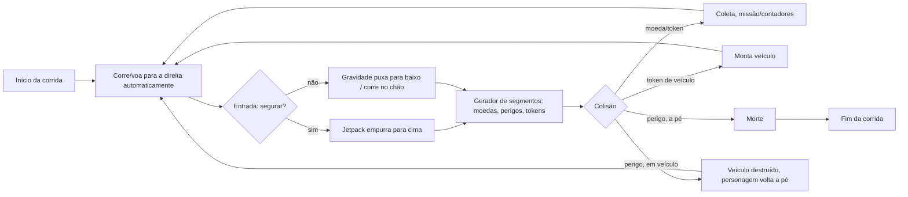

# 03 — Gameplay, personagem, controles e física

## 1. Loop central

| Regra | Conf. |
|---|---|
| Corrida infinita lateral, rolagem automática para a direita | [C] (S1) |
| Um único comando: tocar/segurar para subir, soltar para cair | [C] (S1) |
| Contato com zapper, laser ou míssil mata instantaneamente quando a pé | [C] (S1) |
| Em veículo, um impacto destrói o veículo e o personagem continua a pé (exceto S.A.M., que aguenta 3 mísseis) | [C] (S2) |
| Pontuação principal = distância em metros | [C] (S1) / [G] unidade "m" |
| Cientistas no cenário são não-letais; podem ser derrubados (missões usam isso) | [C] (S5 — Flash derruba cientistas) |

## 2. Personagem (referência funcional)

| Aspecto | Observação | Conf. |
|---|---|---|
| Posição horizontal | Fixa em ~20–25 % da largura da tela; o mundo se move | [G] / [E] 22 % |
| Estados | Correndo no chão; voando (jetpack ativo, partículas de "escapamento" para baixo); caindo; colisão/morte (ragdoll com quiques e deslizamento pelo chão) | [G] |
| Animação de morte | Corpo é arremessado, quica algumas vezes e desliza até parar; distância final é contada até a parada | [G] |
| Hitbox | Menor que o sprite (tolerância a "raspões") | [H] — padrão do gênero |
| Jetpack disparando | O escapamento do jetpack derruba cientistas abaixo | [G] |

**Personagem próprio:** a implementação usará um protagonista original
(nome, design e animações próprias).

## 3. Controles

| Entrada | Efeito | Conf. |
|---|---|---|
| Toque/segurar | Força para cima contínua enquanto pressionado | [C] |
| Soltar | Apenas gravidade age | [C] |
| Toque curto | Pequeno impulso; permite "pairar" alternando toques | [G] |
| Limites | Chão e teto do corredor do laboratório; o personagem não sai da tela | [G] |
| Em veículo | Mesmo botão único, mas semântica muda por veículo (ver doc 05) | [C] |

## 4. Física — parâmetros estimados para a implementação

Os valores originais **não são conhecidos**. Abaixo, valores **[E]**
propostos para o protótipo, a calibrar na Fase 5 por comparação com vídeo.
Unidade: 1 u = altura do personagem; altura jogável ≈ 7 u.

| Parâmetro | Valor inicial [E] | Comentário |
|---|---|---|
| Gravidade | −38 u/s² | queda "pesada", típica do gênero |
| Empuxo do jetpack (aceleração) | +70 u/s² (líquido ≈ +32 u/s²) | sensação de resposta rápida |
| Velocidade vertical máx. subindo | +11 u/s | evita "foguete" |
| Velocidade vertical máx. caindo | −14 u/s | |
| Velocidade horizontal inicial | 8 u/s (≈ 8 m/s no contador) | [H] 1 u ≈ 1 m |
| Aceleração horizontal | +0,05 u/s² até o teto | aumenta lentamente com a distância |
| Velocidade horizontal máx. | 20 u/s | [H] |
| Teto/chão | colisores sólidos; velocidade vertical zera ao tocar | |
| Morte (ragdoll) | quique com restituição 0,4, atrito 0,3 até v < 0,5 u/s | |

## 5. Detecção de colisão (proposta)
- Personagem: `CapsuleCollider2D` ~70 % do sprite.
- Perigos: colisores **trigger** com forma real do feixe (zapper rotativo usa
  `BoxCollider2D` rotacionado junto com o objeto).
- Coletáveis: `CircleCollider2D` trigger; ímã aumenta raio de atração (não o colisor).
- Ordem: coleta antes de dano no mesmo quadro [H].
