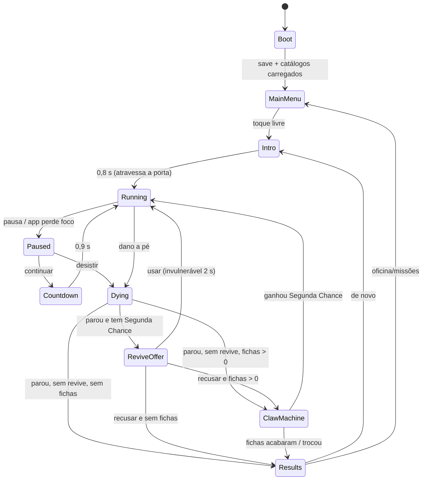
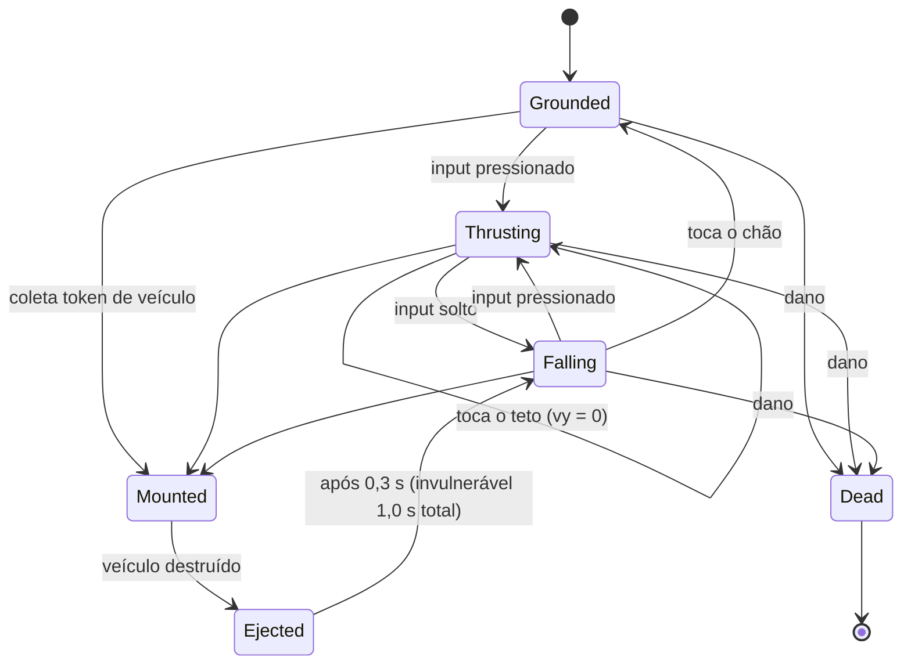
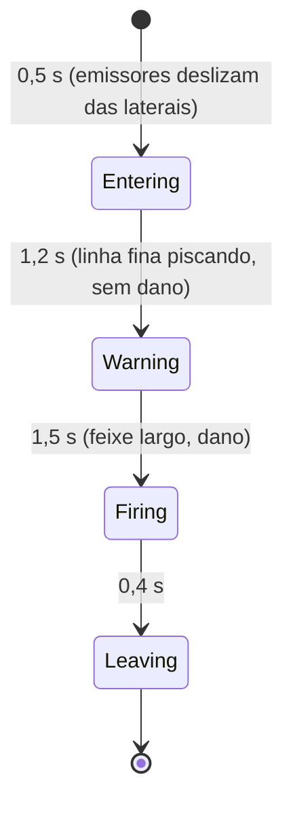
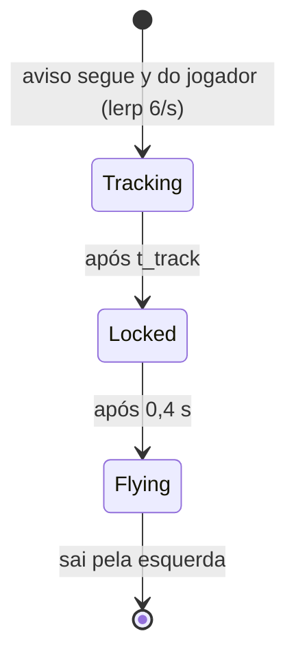

# Fase 3 — Mapeamento dos sistemas

Máquinas de estado, fluxos e regras que a implementação seguirá. Comportamentos
marcados [C] seguem a referência; os demais são decisões de design [H]/[E].

## 1. Ciclo de vida da partida (`GameManager`)



## 2. Jogador (`PlayerController`)



Regras:
- Em `Mounted`, o `PlayerController` **cede o controle** ao veículo ativo (o input é roteado ao `IVehicle`).
- `Dead` ativa o ragdoll; a distância continua contando até a velocidade horizontal < 0,5 u/s.
- Invulnerabilidade: piscar 8 Hz, colisões com perigos ignoradas.

## 3. Veículos (interface comum)

```
IVehicle
  OnMount(PlayerContext)    // posiciona, troca sprite, define física própria
  OnInputDown() / OnInputHeld(dt) / OnInputUp()
  Tick(dt)
  OnHit(HazardType) -> bool destroyed
  OnDismount()              // explosão, ejeta jogador
```

| Veículo próprio | Função [C] equivalente | Física própria [E] | Input |
|---|---|---|---|
| Mecha Pisão | saltador com planar | g = −45; salto vy = +16; segurando: g ×0,35 enquanto vy < 0 | toque = salto (só no chão); segurar = planar |
| Drone-Asa | voador por batidas | g = −30; toque/segurar: aceleração +60 | igual ao jetpack, mais suave |
| Cápsula Blink | teleporte direcional | sem gravidade; ponteiro oscila ±60° a 1,5 Hz; toque teleporta 2,5 u na direção | toque |
| Moto-Trilho | moto rápida com salto | velocidade ×1,5 crescente até ×2; salto vy +14; **bloqueia drones** [C] | toque = salto |
| Serpente-Céu | voador invertido | flutua no teto com onda senoidal (A = 0,4 u, 1 Hz); segurar = desce a 8 u/s | segurar desce |
| Traje Inverso | inversão de gravidade | g = ±40; toque inverte sinal; no ar deve vencer o momento [C] | toque |
| Jet-Esqui | aquático | nível d'água a 30 % da altura; segurar = mergulha; soltar = empuxo de saída; toque no ar = g ×2 [C] | segurar/soltar |
| Guindaste Blindado | resistente | 3 pontos de vida contra drones [C]; 1 contra arcos/feixes [H] | toque = braço agarra robôs (cosmético/missão) |

Destruição: explosão (partículas + tremor de câmera 0,25 s), sprite do veículo cai, jogador ejetado com vy = +8.

## 4. Perigos

### 4.1 Arco de faíscas (zapper)
Estados: `Static` | `Rotating(ω)`. Parâmetros: comprimento L ∈ {2, 3, 4, 5} u, ângulo inicial ∈ {0°, 45°, 90°, 135°}, ω ∈ {0, ±60, ±90}°/s.

### 4.2 Feixe de corte (laser)

- Emissores presos à câmera. Enquanto qualquer laser está ativo, `MissileController` fica bloqueado [C].

### 4.3 Drone-foguete (míssil)

- `t_track` cai de 1,4 s (0 m) para 0,6 s (≥ 3000 m) [C: diminui com a distância].
- Variantes: simples (1), rajada (3–6, espaçamento 0,25 s, y em leque) [C].
- Velocidade de voo: 30 u/s relativa à câmera [E].

## 5. Geração do cenário (`EnvironmentManager` + `ObstacleManager`)

- O mundo é uma sequência de **segmentos** (`SegmentDef`, largura 20–40 u) com: decoração de fundo, padrões de perigo, formações de porcas, pontos de spawn de fichas/tokens de veículo.
- Seleção por peso: `peso(seg, d) = seg.baseWeight × curva(seg.dificuldade, d)`; não repetir o mesmo segmento nas últimas 3 escolhas.
- **Validador de caminho livre** (editor + teste automatizado): para cada segmento, existe ao menos um corredor de altura ≥ 1,6 u alcançável com a física do jetpack.
- Seções visuais trocam a cada 400–700 m com segmento de transição (porta de galpão).
- *Object pooling* para todos os objetos (sem `Instantiate` durante a corrida).
- Eventos especiais de geração: token de veículo a cada 250–450 m quando a pé [E]; ficha a cada 300–600 m [E]; nunca dentro de perigo.

## 6. Coletáveis
| Item | Efeito |
|---|---|
| Porca | +1 (×2 com bônus "Dobro"); formações: linha, arco, onda, letras/ícones próprios |
| Ficha | +1 ficha (para a Garra da Sorte) |
| Token de veículo | monta veículo aleatório entre os desbloqueados (pesos iguais [H]) |

## 7. Catálogo de eventos (event bus)

| Evento | Payload | Emissor | Ouvintes |
|---|---|---|---|
| `RunStarted` | seed | GameManager | todos os managers de corrida, Audio, UI |
| `RunEnded` | RunResult | GameManager | Economy, Mission, Achievement, Save, UI |
| `DistanceChanged` | metros | PlayerController | UI, Mission, Obstacle (dificuldade) |
| `CoinCollected` | valor | CoinManager | Economy(run), Mission, UI, Audio |
| `TokenCollected` | — | CoinManager | Economy(run), UI |
| `VehicleMounted` / `VehicleDestroyed` | VehicleId | VehicleManager | Mission, Achievement, Audio, Missile (bloqueio) |
| `HazardNearMiss` | HazardType | PhysicsController | Mission |
| `PlayerDied` | HazardType | PlayerController | GameManager, Mission, Achievement |
| `WorkerKnocked` | — | Environment | Mission |
| `MissionProgress` / `MissionCompleted` | MissionId | MissionManager | UI, Save |
| `RankUp` | nível | MissionManager | Economy, UI |
| `PurchaseCompleted` | ItemId | StoreManager | Inventory, Save, UI |
| `BalanceChanged` | moeda, saldo | EconomyManager | UI |
| `PrizeWon` | PrizeId | Garra (UI/Economy) | Economy, Achievement |

## 8. Fluxograma da gameplay (por quadro)

```
Input → PlayerController/Vehicle (intenção)
      → PhysicsController (integra velocidade, limites chão/teto)
      → CameraController (segue x, y fixo)
      → EnvironmentManager (recicla segmentos atrás da câmera, gera à frente)
      → ObstacleManager / MissileController (estados de perigo)
      → Colisões (Unity Physics2D triggers) → coleta antes de dano
      → Managers emitem eventos → UI/Audio reagem
```
