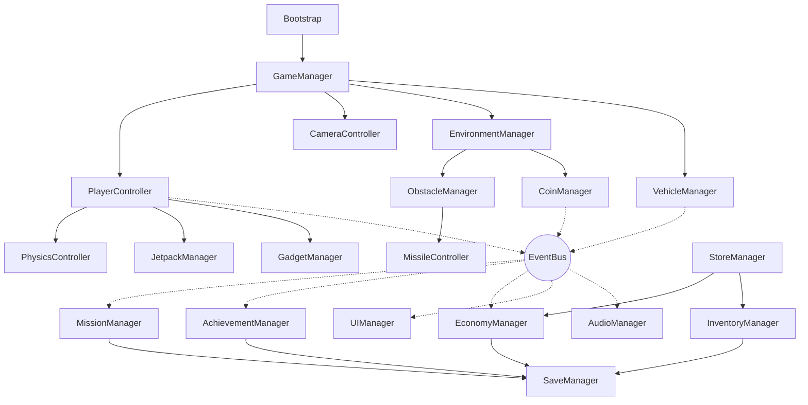

# Fase 4 · 01 — Arquitetura técnica (Unity 2D / C#)

## 1. Princípios
1. **Um componente, uma responsabilidade.** Nenhum "God script".
2. **Dados em ScriptableObjects** (`*Def`), estado em classes C# puras, apresentação em `MonoBehaviour`.
3. **Comunicação por eventos** (event bus tipado) — managers não se referenciam diretamente, exceto dependências declaradas abaixo.
4. **Lógica testável sem Unity:** regras (economia, missões, geração, física do jogador) ficam em assemblies `Core` sem `UnityEngine`, cobertas por testes EditMode/NUnit.
5. **Determinismo:** um `IRandom` com semente por corrida (geração e Garra da Sorte reproduzíveis em teste).

## 2. Camadas e assemblies

```
Propulsor.Core        (C# puro: modelos, regras, eventos, IRandom, IClock)
Propulsor.Data        (ScriptableObjects *Def; depende de Core)
Propulsor.Gameplay    (MonoBehaviours de corrida; depende de Core, Data)
Propulsor.UI          (telas, HUD; depende de Core, Data)
Propulsor.Services    (Save, Audio, plataforma; depende de Core)
Propulsor.Bootstrap   (composição: cria e injeta tudo)
Tests.EditMode / Tests.PlayMode
```



## 3. Componentes

Formato: **Resp.** responsabilidade · **Entra** · **Sai** · **Dep.** · **Eventos** (emite ⇢ / ouve ⇠) · **Regras**.

### 3.1 GameManager
- **Resp.:** máquina de estados da partida (doc 3·01 §1); inicia/encerra corridas; controla `timeScale`.
- **Entra:** comandos da UI (Iniciar, Pausar, Continuar, Desistir, Reviver), `PlayerDied`.
- **Sai:** `RunResult { distância, porcas, fichas, causaMorte, estatísticas }`.
- **Dep.:** EventBus, IRandom (gera seed).
- **Eventos:** ⇢ `RunStarted`, `RunPaused`, `RunResumed`, `RunEnded`, `GameStateChanged` · ⇠ `PlayerDied`, `PrizeWon(SecondChance)`.
- **Regras:** transições só as do diagrama; perder foco do app ⇒ `Paused`; revive no máximo 1 por consumível, ilimitado por corrida [H].

### 3.2 PlayerController
- **Resp.:** estado do personagem (Grounded/Thrusting/Falling/Mounted/Ejected/Dead); traduz input em intenção; roteia input ao veículo; invulnerabilidade.
- **Entra:** `IInputSource` (pressionado/segurando/solto), colisões.
- **Sai:** intenção de empuxo → PhysicsController; `DistanceChanged`.
- **Dep.:** PhysicsController, JetpackManager (visual), GadgetManager (modificadores).
- **Eventos:** ⇢ `PlayerDied(HazardType)`, `PlayerLanded`, `PlayerStateChanged`, `DistanceChanged` · ⇠ `VehicleMounted`, `VehicleDestroyed`, `RunStarted`.
- **Regras:** distância = (x − x₀) em metros (1 u = 1 m); morto continua contando até parar.

### 3.3 PhysicsController
- **Resp.:** integração vertical/horizontal própria (cinemática, não `Rigidbody` dinâmico) para controle fino; limites chão/teto; ragdoll de morte; detecção de "raspão".
- **Entra:** `PhysicsParams` (de `PlayerPhysicsDef` + modificadores de gadgets/veículo), intenção, dt fixo (50 Hz).
- **Sai:** posição/velocidade; `HazardNearMiss`.
- **Dep.:** nenhuma (lógica em `Core.PlayerMotor`, testável).
- **Regras:** `vy += (g + thrust·a) dt`, *clamp* a [vMinY, vMaxY]; ao tocar chão/teto, vy = 0; vx = f(distância) com aceleração e teto (doc 1·03 §4).

### 3.4 CameraController
- **Resp.:** segue x do jogador mantendo-o a 22 % da largura; y fixo; tremores; altura visível constante entre proporções.
- **Entra:** posição do jogador, `CameraShake(intensidade, duração)`.
- **Eventos:** ⇠ `VehicleDestroyed`, `PlayerDied`, `LaserFiring`.
- **Regras:** `orthographicSize` fixo; ajuste pela largura apenas.

### 3.5 EnvironmentManager
- **Resp.:** fluxo de segmentos (spawn à frente, reciclagem atrás), seções visuais, parallax, robôs operários.
- **Entra:** posição da câmera, distância, `SegmentDef[]`, IRandom.
- **Sai:** segmentos instanciados (via pool) → repassa padrões a ObstacleManager e CoinManager.
- **Eventos:** ⇢ `SectionChanged`, `WorkerKnocked` · ⇠ `RunStarted`.
- **Regras:** seleção por peso e curva de dificuldade; sem repetição nas últimas 3; transição de seção a cada 400–700 m.

### 3.6 ObstacleManager
- **Resp.:** arcos de faísca (estáticos/rotativos) e feixes de corte (lasers) e seus estados.
- **Entra:** padrões do segmento; distância (dificuldade).
- **Eventos:** ⇢ `LaserSequenceStarted/Ended`, `LaserFiring`.
- **Regras:** lasers presos à câmera; enquanto ativos, sinaliza bloqueio de drones; nenhum perigo nasce sobre um token/ficha.

### 3.7 MissileController
- **Resp.:** agendar e executar drones-foguete (aviso → travado → voo), rajadas.
- **Entra:** distância, y do jogador, bloqueios (laser ativo, Moto-Trilho).
- **Eventos:** ⇢ `MissileWarning`, `MissileLaunched` · ⇠ `LaserSequenceStarted/Ended`, `VehicleMounted/Destroyed`.
- **Regras:** intervalo entre eventos de drone diminui com a distância; `t_track` 1,4 → 0,6 s; rajadas a partir de 1500 m [E].

### 3.8 CoinManager
- **Resp.:** formações de porcas, fichas, tokens de veículo; coleta; atração (ímã).
- **Entra:** formações do segmento, raio de ímã (GadgetManager), multiplicador (Dobro).
- **Eventos:** ⇢ `CoinCollected(valor)`, `TokenCollected`, `VehicleTokenCollected`.
- **Regras:** porcas da corrida ficam em *run wallet* até `RunEnded`.

### 3.9 VehicleManager
- **Resp.:** escolher e instanciar o veículo ao coletar token; ciclo de vida `IVehicle`; aplicar skin equipada.
- **Entra:** `VehicleDef[]` desbloqueados, Inventory (skins), input roteado.
- **Eventos:** ⇢ `VehicleMounted(id)`, `VehicleDestroyed(id)` · ⇠ `VehicleTokenCollected`.
- **Regras:** 1 veículo por vez; token coletado montado é ignorado (vira 10 porcas [H]); Guindaste Blindado com 3 PV contra drones.

### 3.10 JetpackManager
- **Resp.:** aplicar o propulsor equipado (partícula, som, sprite). **Cosmético**.
- **Entra:** `JetpackDef` equipado.
- **Regras:** sem impacto na física (garante justiça entre itens).

### 3.11 GadgetManager
- **Resp.:** aplicar modificadores dos gadgets equipados no início da corrida.
- **Entra:** `GadgetDef[]` equipados (≤ slots).
- **Sai:** `RunModifiers { raioIma, multGravidade, pulosAoAterrissar, ajudante, garantiaUltimaFicha, ... }`.
- **Regras:** modificadores combinam por regras declaradas (soma/multiplica/booleano).

### 3.12 MissionManager
- **Resp.:** 3 missões ativas, progresso, conclusão, estrelas, patentes, prestígio, pular missão.
- **Entra:** eventos de gameplay; `MissionDef[]`, `RankTableDef`.
- **Eventos:** ⇢ `MissionProgress`, `MissionCompleted`, `RankUp`, `PrestigeEarned` · ⇠ `RunStarted`, `RunEnded`, `CoinCollected`, `DistanceChanged`, `WorkerKnocked`, `VehicleMounted`, `HazardNearMiss`, `PlayerDied`...
- **Regras:** missões de escopo `Run` zeram no `RunStarted`; `Lifetime` acumulam; reposição ocorre no `RunEnded` (não no meio da corrida) [H]; pular custa 500 porcas × estrelas [C].

### 3.13 AchievementManager
- **Resp.:** conquistas permanentes baseadas em estatísticas acumuladas.
- **Entra:** `AchievementDef[]`, `StatsData`.
- **Eventos:** ⇢ `AchievementUnlocked`.
- **Regras:** avaliação no `RunEnded` e em eventos pontuais; idempotente.

### 3.14 StoreManager
- **Resp.:** catálogo da Oficina, validação e execução de compras.
- **Entra:** `ItemDef[]`, pedido de compra.
- **Sai:** `PurchaseResult { Ok | SaldoInsuficiente | JaPossui | Bloqueado }`.
- **Dep.:** EconomyManager, InventoryManager.
- **Regras:** transação atômica: debita → concede → salva; em falha, reverte.

### 3.15 InventoryManager
- **Resp.:** itens possuídos, quantidades de consumíveis, itens equipados por espaço.
- **Regras:** equipar valida posse e limite de slots; consumir decrementa e salva.

### 3.16 EconomyManager
- **Resp.:** saldos (porcas, fichas), *run wallet*, recompensas, troca de fichas (100 porcas/ficha [C*]).
- **Eventos:** ⇢ `BalanceChanged` · ⇠ `RunEnded`, `RankUp`, `PrizeWon`.
- **Regras:** saldo nunca negativo; toda alteração passa por `TryDebit/Credit` com motivo (log para teste).

### 3.17 UIManager
- **Resp.:** pilha de telas, transições, HUD, pop-ups em fila.
- **Regras:** telas são `UIScreen` com `Show/Hide` assíncronos; nenhuma regra de negócio em UI.

### 3.18 AudioManager
- **Resp.:** música por estado (menu/corrida/garra), efeitos com pool de `AudioSource`, volumes persistidos.
- **Regras:** ducking da música −6 dB durante aviso de drone; respeita configurações.

### 3.19 SaveManager
- **Resp.:** carregar/salvar `SaveData` (JSON), migração de versão, escrita atômica, recuperação de corrupção (backup `.bak`).
- **Regras:** salva em `RunEnded`, compra, equipar, configuração, `OnApplicationPause(true)`.

## 4. Estrutura de pastas do projeto Unity

```
Assets/
  _Project/
    Scripts/
      Core/        (Events, Models, Rules, Random)
      Data/        (Defs)
      Gameplay/    (Player, Physics, Camera, Environment, Obstacles, Missiles, Coins, Vehicles, Gadgets)
      UI/          (Screens, HUD, Widgets)
      Services/    (Save, Audio, Input)
      Bootstrap/
    Data/          (assets .asset dos Defs)
    Art/ Audio/ Prefabs/ Scenes/
  Tests/
    EditMode/ PlayMode/
```
